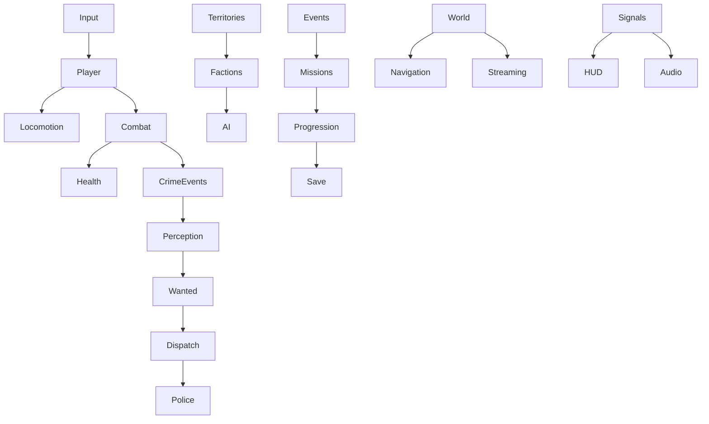

# Arquitetura — OPERAÇÃO CAOS

## Estado entregue

Godot 4.7, GDScript, cena principal minimalista e criação procedural em `game.gd`. `Player`, `Vehicle`, `Pedestrian`, `WantedSystem`, `City`, `CameraRig`, `DayNight`, `GameHUD` e `Radar` permanecem em uso. APIs públicas de carro, avião, câmera e entrada existentes foram preservadas.

Novos módulos: `Locomotion` controla buffer/coyote/salto sem assets ou renderer; `Player` aplica impulso pelo motor de física existente. `TouchControls` fornece intenções consumíveis e corrida mantida. `CameraRig` usa esfera reutilizada para proteger volume da câmera e raycast complementar para paredes próximas, com máscara world. `GraphicsProfile` configura iluminação por qualidade; DayNight guarda o perfil da sessão. Esses módulos não exigem um novo autoload ou framework.

## Evolução proposta (não implementada ainda)

Extrair serviços de `game.gd` uma responsabilidade por vez; manter Game como composição e adaptação do fluxo legado. Preferir sinais tipados e Resources com dados às consultas globais repetidas. Nenhum evento de tiro deve editar missão, reputação e HUD diretamente: Health recebe dano; CrimeSystem registra autoria e testemunha; consumidores decidem consequências.

- **Combat/Health**: dano com origem, equipe e hit location; arma com carregador/reserva, cadência, spread e recarga. Cobertura valida geometria e espaço de saída. Animações são apresentação do estado, não autoridade de dano.
- **Perception/AI**: visão com cone+LOS, audição, memória limitada e estados explícitos. NPC distante recebe ticks menos frequentes. Aliados e inimigos compartilham navegação e saúde, com decisão por relação.
- **Wanted/Dispatch**: crime não implica onisciência. Preservar last_seen, busca e decay; spawn de resposta precisa via válida, distância e ausência de visão direta. Escalada não significa spawn ilimitado.
- **Factions/Territories**: IDs de facção próprios, relação simétrica base mais reputação individual, influência por zona e transição por limiar. Disputas emitem eventos; polícia é ator distinto, com regras próprias.
- **Missions/Events**: Resource com IDs, condições e objetivos; instância guarda progresso; recompensa idempotente. Diretor de eventos respeita cooldown, limite de agentes e prioridade da missão. Humor em situações/textos originais, mantendo combate sério.
- **World/Save**: entidades com ID estável, chunks com histerese e unload seguro; save contém estado de dados, nunca NodePaths frágeis. Versão, escrita temporária, backup e validação antes de carregar.
- **Presentation**: HUD, minimapa e áudio assinam sinais. Gráficos têm LOW/MEDIUM/HIGH; densidade e distância deverão seguir perfil sem alterar regras de missão.

## Identidade e recursos

História, elenco, facções, mapas e textos do OPERAÇÃO CAOS serão originais. Usar apenas assets locais com licença compatível ou novos assets próprios; conservar MIT e créditos. A referência serve para comportamento visível. Nenhum código, shader, modelo, textura, música ou pacote de dados proprietário da referência entra no projeto.

## Limitações atuais

O salto ainda não tem clip dedicado. Não existem cobertura, save, facções ou streaming Godot. LOW não elimina todos os custos de texturas, reflections e luzes locais. A suíte headless valida lógica/física e inicialização, não qualidade visual, FPS ou consumo de GPU. A trilha Unity não faz parte desta implementação.
