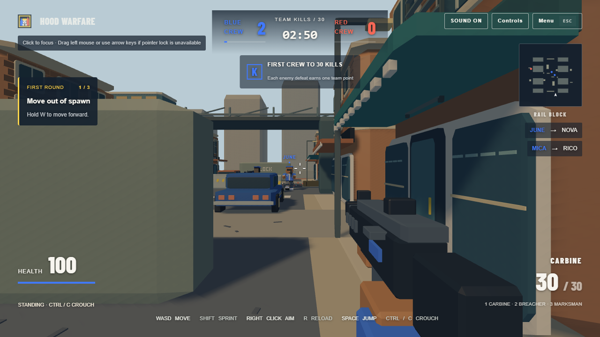

# Auditoria da referência Hood Warfare

Data: 14/10/2026. M1. REA MCP conectado, pacote `rea-agents 6.4.0`, Chrome `155.0.8059.79`. Investigação das URLs fornecidas pelo usuário, sem aquisição do jogo Steam ou reutilização de código/assets externos.

## Identidade das duas referências

A [página Steam de Hood Warfare](https://store.steampowered.com/app/2274510/Hood_Warfare/) identifica Trapstar Games. A descrição pública declara FPS urbano, equipes, controle territorial, partidas offline com bots, multiplayer, sobrevivência contra zumbis, chat de voz e progressão com desbloqueios. Essa descrição foi lida com REA; o executável Steam não foi executado. Parâmetros de movimento, armas e IA permanecem **NÃO VERIFICADO**.

O [jogo de navegador fornecido](https://hoodwarfare.app/play?mode=solo) é uma referência complementar distinta. Seu HTML informa: “Independent project. Not affiliated with Trapstar Games or the Steam title.” Isso foi observado no DOM capturado, não inferido pelo nome. O browser não comprova comportamento do jogo Steam.

## Observações reais do navegador

REA abriu processos Chrome próprios, sem usar o perfil pessoal. A entrada `mode=solo` mostrou tentativa de conexão; atividade posterior à captura curta é desconhecida. O menu oferece prática local, dois modos, três dificuldades e opções de sala. O aviso inicial interceptou o primeiro clique; fechar o aviso permitiu prosseguir.

Na prática local, REA observou perspectiva FPS e HUD. Agachar e saltar alteraram o estado visível; troca de arma mudou carregador de 30 para 6. Pausa abriu via Escape. Bots produziram eliminações e pontuação. Selecionar controle territorial e dificuldade difícil abriu uma partida com objetivo A. Capturar o território, vitória, dano ao jogador e respawn não foram testados.

Os cliques de tiro e a tecla de recarga foram enviados, porém a munição não mudou: **NÃO VERIFICADO**. Teclas breves não permitem medir deslocamento sustentado, stamina, aceleração, recuo ou velocidade. Networking, voz e progressão não foram exercitados. Interface presente no DOM não prova funcionamento de seus sistemas.

## Evidências conservadas

Cada JSON abaixo contém o registro completo retornado pelo REA, inclusive parâmetros, passos, artefatos, limitações e screenshots codificadas. PNGs extraídos usam exatamente os bytes capturados. São material de auditoria, não assets do OPERAÇÃO CAOS.

| Registro | Evidence ID | Cobertura |
|---|---|---|
| [Steam](evidence/hood_steam_page.json) | `ev_7835b0973394793ab27b3fdc6d504b7db1bbf0b8424b15bc9f6615478a58b506` | Página pública, descrição; não execução Steam |
| [Entrada solo](evidence/hood_solo_connection.json) | `ev_157fc4ba31061d52af52f149ac75d8c4686e99680bb3725b91cc02adce957f45` | Menu/conexão, DOM e identidade |
| [Aviso bloqueando clique](evidence/hood_modal_block.json) | `ev_0e2af168b6d4885ec3a97dff8f9001169a83e6937767be5ec3d89317548d484f` | Timeout de clique, sem gameplay |
| [Entrada prática](evidence/hood_practice_entry.json) | `ev_cfb3677430025c0b607f4feab72110185006a00d2de8bfae86762012a817f41e` | Prática inicia diretamente; botão de confirmação ausente |
| [Controles](evidence/hood_controls.json) | `ev_5bd7b2efe7f8675f5bcaf2006bad59880fdccf8b83b2ecb4786ea5ebb29fd9df` | Agachar, salto, troca e pausa |
| [Bots](evidence/hood_bot_combat.json) | `ev_285ce0247d2bf69a1a11bd4bee53efbaa3db84cc17171a9c56411904a44cc412` | Placar 0→2, killfeed, visual FPS |
| [Território](evidence/hood_turf.json) | `ev_2b6c943276e730272cec86367695f9232d6e62c3ee22a61fe4a8a8f58c85f281` | Seleção modo/dificuldade, objetivo A; captura não exercitada |

## Ferramentas e limites

`binary_session` confirmou conexão/catálogo; `capture_browser_scenario` executou os cenários. A descoberta de CDP indisponível do turno anterior não foi repetida: o cenário ativo lançou um navegador novo e encerrou somente seu processo próprio. A primeira chamada revelou incompatibilidade de argumentos; o schema instalado foi consultado antes da chamada corrigida. `web.run` também leu a página Steam; a URL browser falhou nessa ferramenta, mas funcionou no REA.

Os registros têm autoridade `controlled-replay` e confiança `observed` para os estados capturados. Identidade de um artefato distribuído não foi fornecida. Ordem de eventos é ordem de recepção, não prova causalidade simultânea. Rede não reteve payloads/headers; requisições pendentes no fim permanecem desconhecidas. Áudio headless não foi escutado. Não se extraíram fontes de gameplay do browser. O replay suporta pressões breves, não uma medição completa de sensibilidade/movimento.

## Decisões próprias para OPERAÇÃO CAOS

FPS urbano, combate por equipes e objetivos curtos são direção de implementação. Bandeiras 5v5, Battle Royale de oito participantes, mapas brasileiros, stamina e ENet são requisitos do usuário; não se atribuem essas escolhas à referência sem evidência. Equivalência mecânica será validada por testes próprios, sem prometer reprodução exata de balanceamento desconhecido.
